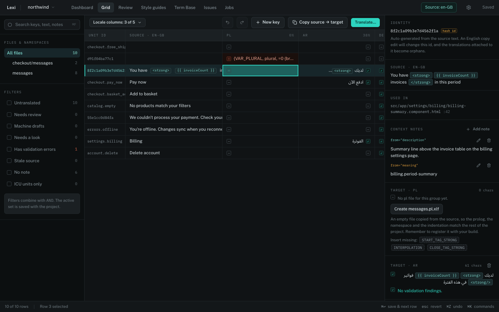
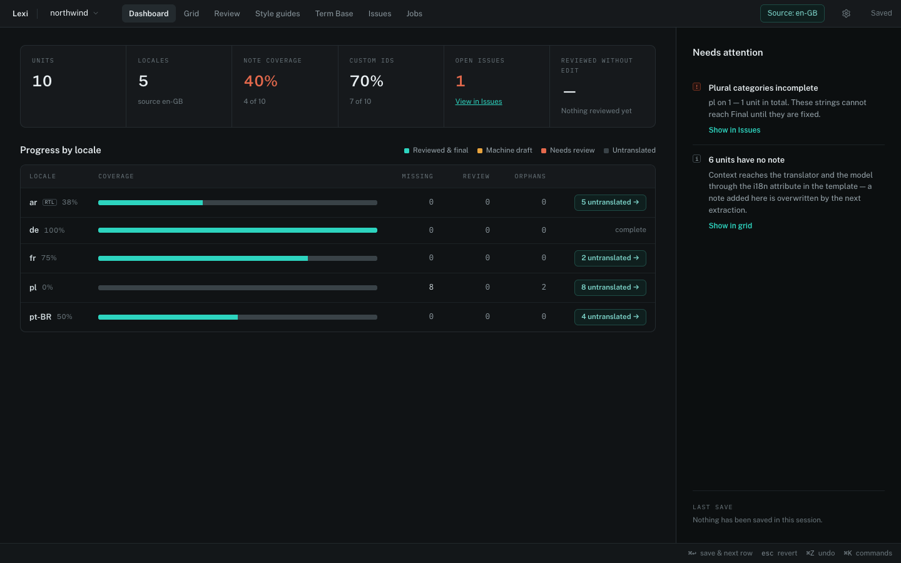
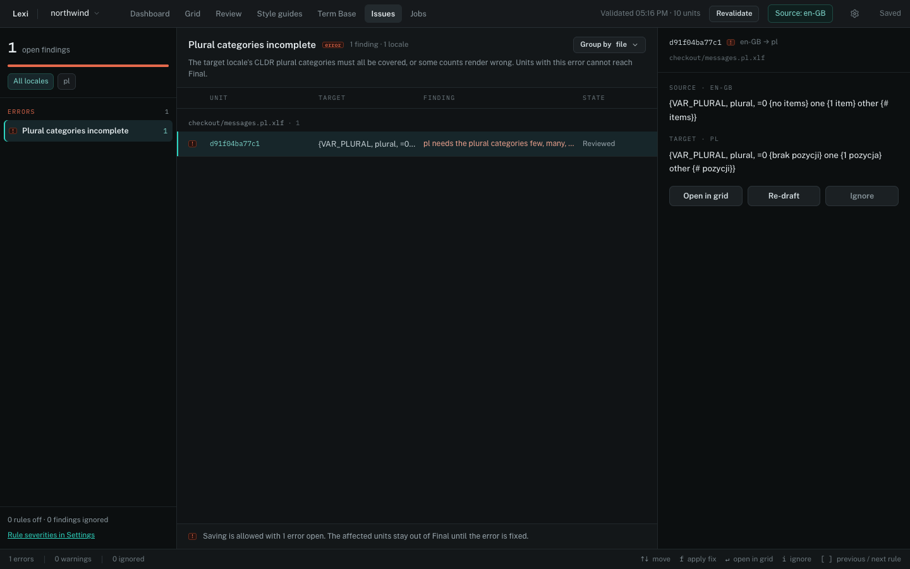

# Lexi

**Review and manage the translations of your app — locally, without mangling your files.**

Lexi opens your translation files, shows every translation unit in a key-by-locale grid, tells you
at a glance what is still untranslated, and drafts translations with a language model you choose —
steered by your own style guides, a term base and the context notes already in the files. Saving writes back only what you changed: a one-word edit is a one-line diff.

Lexi starts with the XLIFF 1.2 files that Angular's `ng extract-i18n` produces. Support for more
translation file formats is planned.

Created and maintained by **Patrick Glück**. Lexi is free and open source software under the
[GNU General Public License v3.0 or later](LICENSE). See
[License](#license).



## Why Lexi

- **Your files stay yours.** Lexi never regenerates a translation file. It splices edits into the
  original text, so opening and saving a file changes nothing, and an edit touches exactly the
  lines it has to. Placeholders such as `<x id="INTERPOLATION"/>` keep their original bytes.
- **Local first.** Lexi runs on your machine, binds to `127.0.0.1` and has no account and no
  telemetry. The only outbound requests go to the translation service you configure.
- **Built for review, not just for drafting.** Every machine draft stays marked as one until a
  person accepts, corrects or rejects it, and Lexi measures how often drafts are accepted without
  a change.

## Features

- **Grid** across all locales: filter by state, file, validation errors, missing notes or ICU
  messages, and search keys, text and notes. Handles tens of thousands of units smoothly.
- **Placeholder-safe editor**: placeholders appear as atomic chips that cannot be split or
  mistyped, right-to-left locales render correctly, and a save is refused if the placeholders no
  longer match the source. Edit in the detail panel or inline in the grid; undo and redo work
  across edits.
- **Dashboard** with coverage per locale, note coverage, custom-id share, open issues and the
  share of machine drafts accepted without edit.
- **Validation** with configurable rules: placeholders, ICU syntax and CLDR plural categories,
  whitespace, glossary terms and more. The **Issues** screen groups findings by rule, applies a
  fix in one key when exactly one fix is right, and lets you ignore a finding until the source
  text changes.
- **Machine drafts** from any OpenAI-compatible endpoint (for example a local model in LM Studio
  or Ollama) or GitHub Copilot. Translate one unit, or run background **jobs** across several
  locales with pause, resume, cancel, a run log and CSV or HTML reports. You can preview the
  exact prompt before it is sent.
- **Review** queue for machine drafts: source, a word diff against the displaced text, the checks
  that passed or failed, and keyboard shortcuts to accept (`A`), reject (`R`) or correct (`E`).
- **Style guides** in Markdown (one global guide plus one per locale) and a **term base** with
  per-locale translations and do-not-translate terms, importable from CSV
  ([format](docs/termbase-csv.md)). Only the terms a string actually contains go into its prompt.
  Both can come from a shared Git repository used by several projects
  ([sharing](docs/shared-sources.md)).
- **Notes**: add and edit context notes, and start a locale that has no file yet.
- **Phrase**: push your files to Phrase Strings using the project's `.phrase.yml`.
- **Desktop app** (Electron) for people who should not need Node or a terminal.

| Dashboard | Issues |
|---|---|
|  |  |

## Getting started

You need [Node.js](https://nodejs.org/) 24 (`.nvmrc` pins 24.21.0; 22.22.3 or newer works).

```bash
git clone https://github.com/paglueck/lexi.git
cd lexi
npm ci
npm run build
npm start                         # opens http://127.0.0.1:4317/ in your browser
```

Then choose **Open folder…** and point Lexi at the folder that holds your `.xlf` files. Lexi
proposes a file-to-locale mapping, which you confirm once. To try it on sample data first, open
`testdata/northwind`.

```bash
npm start -- ~/code/my-app/src/locale   # also grant access to a folder outside your home directory
npm start -- --port 4400 --no-open      # another port, no browser
```

Commit your XLIFF files (or keep a copy) before you work on files you cannot restore.

### Desktop app

The desktop app needs no Node.js. Download the latest release:

| Platform | Download |
|---|---|
| macOS (Apple Silicon) | [Lexi-mac-arm64.dmg](https://github.com/paglueck/lexi/releases/latest/download/Lexi-mac-arm64.dmg) |
| Windows (x64) | [Lexi-Setup-x64.exe](https://github.com/paglueck/lexi/releases/latest/download/Lexi-Setup-x64.exe) |
| Linux (x64) | [Lexi-linux-x86_64.AppImage](https://github.com/paglueck/lexi/releases/latest/download/Lexi-linux-x86_64.AppImage) |

All releases and their notes are on the [releases page](https://github.com/paglueck/lexi/releases).
The builds are not signed, so on first launch:

- **macOS:** the app is ad-hoc signed, not notarized. Open it once and dismiss the warning, then
  go to **System Settings → Privacy & Security**, choose **Open Anyway** next to Lexi, and
  confirm. Alternatively, run `xattr -dr com.apple.quarantine /Applications/Lexi.app` once.
- **Windows:** SmartScreen shows "Windows protected your PC". Choose **More info → Run anyway**.
- **Linux:** make the AppImage executable (`chmod +x Lexi-linux-x86_64.AppImage`) and run it.
  Some distributions need `libfuse2` for AppImages.

To build an installer yourself:

```bash
npm run desktop:mac     # → apps/desktop/release/Lexi-mac-arm64.dmg
npm run desktop:win     # → apps/desktop/release/Lexi-Setup-x64.exe
npm run desktop:linux   # → apps/desktop/release/Lexi-linux-x86_64.AppImage
```

Building the Windows installer on a Mac needs Rosetta (`softwareupdate --install-rosetta`); the
Linux one is best built on Linux.

#### Updates

The desktop app looks for a new version on every start, in the latest
[GitHub release](https://github.com/paglueck/lexi/releases/latest), and offers it in a dialog with
the release notes. **Skip for now** asks again at the next start; **Settings → Updates** checks by
hand. On Windows and Linux (AppImage) the update downloads and installs itself. On macOS, while the app is only ad-hoc signed, Lexi downloads the disk image, opens it and quits;
drag Lexi into Applications to finish. (Squirrel.Mac, which installs updates in place, needs a
Developer ID signature; once the build has one, set `MAC_MODE` in `apps/desktop/updater.mjs` to
`'auto'`.)

To publish a release:

1. Raise `version` in the root `package.json` and write the notes into
   `apps/desktop/build/release-notes.md`. They end up in the release, the update feed and the
   dialog.
2. Commit, then tag and push: `git tag v<version> && git push origin v<version>`.
3. The [Release workflow](.github/workflows/release.yml) builds the installers on macOS, Windows
   and Linux runners and publishes them, with the `latest*.yml` update feeds, as a GitHub
   release. It refuses a tag that does not match `package.json`. A version with a suffix
   (`1.2.0-beta.1`) becomes a prerelease, which neither the download links nor the updater offer.

**Actions → Release → Run workflow** builds the installers without releasing them; they are
attached to the run as artifacts.

To try a release before publishing it, serve `apps/desktop/release/` locally and start Lexi with
`LEXI_UPDATE_URL=http://127.0.0.1:<port>/`. This also enables the updater in
`npm run desktop:dev`, where it is otherwise off.

## Configuration

Everything is configured in the app under **Settings** (`⌘,`).

- **Model:** choose an OpenAI-compatible endpoint (base URL, model, optional API key) or GitHub
  Copilot, and tune the generation parameters. **Test connection** checks separately whether the
  server answers, which models it offers and whether it can complete.
- **Phrase:** an access token for pushing to Phrase Strings. Without one, Lexi falls back to
  `access_token` in `.phrase.yml` and then to `PHRASE_ACCESS_TOKEN`.
- **Validation rules:** set each rule to error, warning or off, per project.
- **Editor**, **Appearance**: placeholder chips or plain-text mode; dark or light theme.
- **Updates** (desktop app only): look for a new version by hand.

Machine settings live in `~/.lexi/`, project settings in `<project>/.lexi/`, which is meant to be
committed. Lexi writes a `.gitignore` there for the files that are one person's scratch state.

## Data handling and privacy

- **Stored per user** in `~/.lexi/`: `settings.json` (endpoint, model parameters and — in plain
  text, file mode `0600` — any API key or Phrase token you enter), `recents.json`, and `copilot/`,
  the working directory of the Copilot SDK.
- **Stored per project** in `<project>/.lexi/`: project settings, style guides, the term base,
  review notes and statistics, ignored findings, unsaved drafts and job logs.
- **Network:** the server binds to `127.0.0.1` only. Outbound requests go only to the translation
  service you configure — an OpenAI-compatible endpoint (only its origin, never following a
  redirect) or GitHub Copilot under your own account — and to the Phrase API when you push.
  The desktop app also asks GitHub (`github.com`, which redirects to its download servers) for
  new versions. That request carries no
  project data, only what electron-updater sends: the app version in the user agent and a random
  installation id (`x-user-staging-id`) meant for staged rollouts. **Strings sent for translation
  leave your machine unless that endpoint is local.**
- **No telemetry**, no analytics, no account.

Because any web page you have open can reach a server on localhost, every API request passes a
`Host` allowlist (against DNS rebinding), `Sec-Fetch-Site` and `Origin` checks and a per-process
token, and file access is confined to the folders you granted. The page's content security policy
forbids it from making outbound requests at all. Details in
[docs/architecture.md](docs/architecture.md#security-model).

## Limitations

- **XLIFF 1.2 only for now**, in the shape Angular's `ng extract-i18n` writes. XLIFF 2.x and other
  formats are not supported yet; more formats are planned.
- **Not built yet:** reconciling translations when Angular's content-hash ids change after an
  English copy edit (FR-2.5), a translation memory, a maximum-length rule, a headless CLI for CI
  (`lexi check`) and a per-unit change history.
- The placeholder chip editor is verified in **Chrome** (and therefore the desktop app). Safari,
  Firefox and input methods (IME) have not been verified; the plain-text editor mode in Settings
  is the fallback.
- The app's own interface is in English.
- Desktop builds are unsigned (see above).

## Development

```bash
npm ci
npm run dev          # Fastify on :4317 + ng serve on :4200, with live reload
npm test             # every workspace (Vitest)
npm run typecheck
npm run lint         # type-checked ESLint + Stylelint
npm run build        # web, server and license files into apps/server/public
```

| Path | What it is |
|---|---|
| `packages/xliff/` | the engine: scanning, segments, ICU, validation, masking, splice writing |
| `packages/shared/` | the wire contract: zod schemas and shared constants |
| `apps/server/` | Fastify 5: security, project index, save path, jobs, prompts, SSE |
| `apps/web/` | Angular 22 single-page app |
| `apps/desktop/` | Electron shell |
| `bin/lexi.mjs` | the CLI that starts the bundled server |
| `testdata/northwind/` | a small synthetic project to open |

`/dev/kitchen-sink` shows every UI component in both themes. `npm run corpus:large` generates a
20,000-unit × 10-locale project in `testdata/large/` for performance work.

Read [docs/architecture.md](docs/architecture.md) before changing the engine, the save path or
the grid. [docs/requirements.md](docs/requirements.md) holds the original requirements that the
`FR-…`/`NFR-…` ids in the code refer to.

## License

Copyright (C) 2026 Patrick Glück and the Lexi contributors.

Lexi is free software: you can redistribute it and/or modify it under the terms of the
[GNU General Public License](LICENSE) as published by the Free Software Foundation, either
version 3 of the License, or (at your option) any later version. It is distributed in the hope
that it will be useful, but **without any warranty**; see the license for details.

In short: you may use Lexi for any purpose, including commercially, study and change it, and pass
it on. If you distribute Lexi or a modified version, you must do so under the same license and
make the corresponding source code available. Third-party components retain their own licenses —
see [THIRD_PARTY_NOTICES.md](THIRD_PARTY_NOTICES.md).

## Contribute

Contributions are welcome — please read [CONTRIBUTING.md](CONTRIBUTING.md). They are accepted
under the same license (GPL-3.0-or-later), with a
[Developer Certificate of Origin](https://developercertificate.org/) sign-off on every commit
(`git commit -s`); there is no CLA. For larger changes, open an issue first.

## Support the project

Lexi is free and built in my spare time. If it saves you or your team work, you can support its
development:

- [Ko-fi](https://ko-fi.com/patrickglueck) — a one-off or monthly contribution
- [GitHub Sponsors](https://github.com/sponsors/paglueck)

Starring the repository, reporting bugs and telling others about Lexi help too.

## Support and security

Use repository issues for reproducible bugs and feature proposals. Do not include confidential
translation files or credentials. For vulnerabilities, follow [SECURITY.md](SECURITY.md).

Lexi is maintained as a side project. No response-time or maintenance SLA is included unless
separately agreed.
